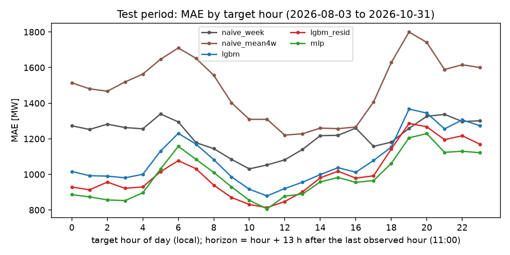
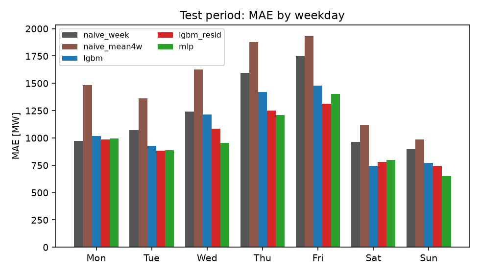
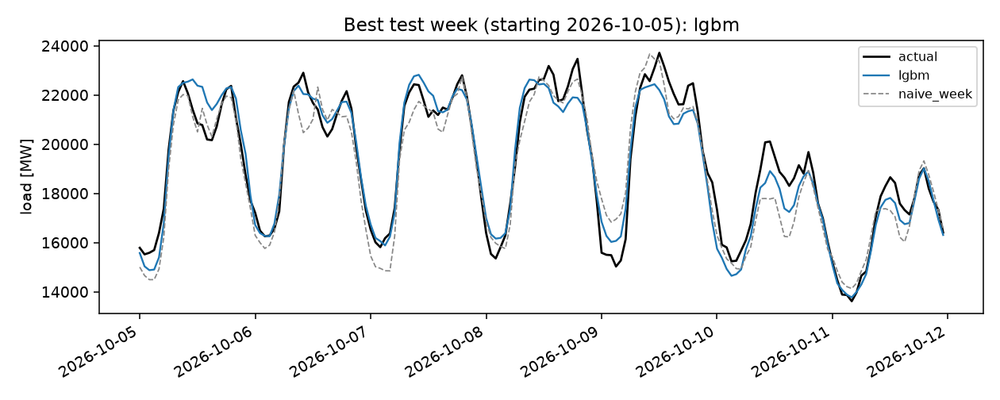
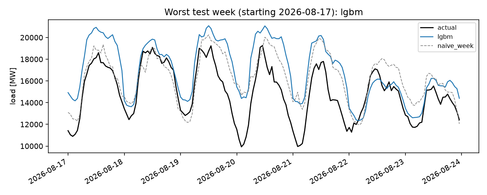
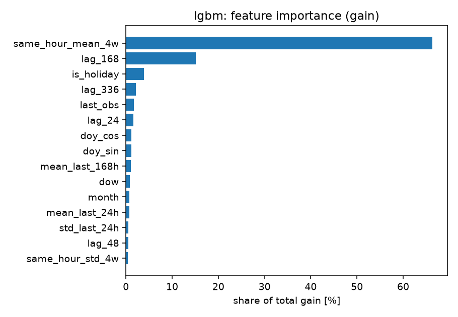
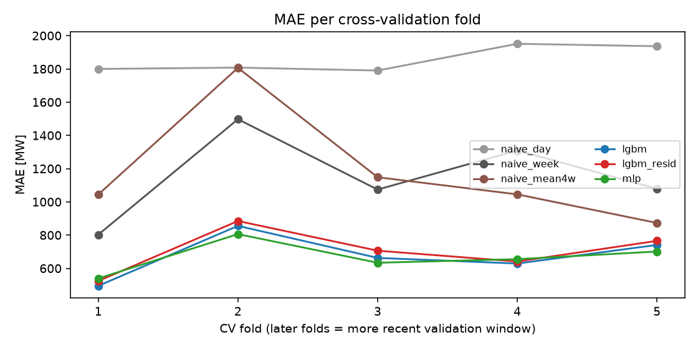

# smardfc: day-ahead load forecast for the Amprion control zone

Hourly electricity load forecasts for the next day, built from public SMARD data
(Bundesnetzagentur, "Realisierter Stromverbrauch", Amprion control zone). The forecast for a
day is issued at 12:00 the day before and uses only data available then. Models:
seasonal-naive baselines, LightGBM and a small PyTorch MLP. Everything is tracked with
MLflow and served through a FastAPI endpoint.

## Summary

- Day-ahead hourly load forecast for the Amprion control area from public SMARD data, issued at
  12:00 the day before; LightGBM and a small MLP against seasonal-naive baselines.
- Against last week's same-hour load, MAE is lower by 11% to 19% on the 2026-08-03 to 2026-10-31
  test period (it contains an unexplained August break) and by 19% to 27% on the same months of
  2025. MAPE: 5.85 to 6.48% (2026 test), 2.81 to 3.10% (2025 backtest).
- Not included: weather inputs, prediction intervals, a comparison with the TSOs' own forecasts.

## Data

- Source: Bundesnetzagentur | SMARD.de, licensed CC BY 4.0 (per the SMARD download page,
  checked 2026-11-08). Filter 410 "Realisierter Stromverbrauch: Gesamt
  (Netzlast)", region `Amprion`, resolution hour, via
  `https://www.smard.de/app/chart_data/410/Amprion/410_Amprion_hour_<timestamp>.json`
  (weekly chunks, cached in `data/raw/`, not committed).
- Region: the Amprion control area (Regelzone), not Germany and not a single state. In
  October 2026 its mean load was 36% of the German total. That is a plausibility check only; it
  does not verify how SMARD assigns load to zones.
- Range: 2022-01-01 00:00 to 2026-10-31 23:00 local time, 42,360 hourly values, downloaded on
  2026-11-08. `data/processed/load.parquet` has SHA-256
  `7dd59c974a09942e8eac567f4998e57b39f74240bcb2d27fb9b156228be647a2`. All files in `results/`
  were computed from it; the test-period actuals in `results/test_predictions.csv` match it
  exactly. SMARD can revise past values, so a later download may differ slightly.

## Results

All numbers in this README come from `results/metrics.json` (the same values are in
`results/results.md` and the CSV files). Evaluation: a final test period of the last 90 days (2026-08-03 to 2026-10-31), not used for
fitting or tuning, and five expanding-window cross-validation folds (60 days each, Oct 2025 to
Aug 2026) shown for comparison. MAE and RMSE in MW, MAPE in %. Skill = 1 - MAE / MAE of
`naive_week`, the same hour one week earlier. `naive_day` is the latest same-hour value available
at the cut-off (yesterday for target hours 00-11, the day before yesterday for 12-23, so it is
weak by construction for the second half of the day). `naive_mean4w` is the mean of the same
hour over the last four weeks. `naive_week` is the best naive baseline by CV MAE (1,152 against
1,183 and 1,857) and also on the test period, so all skill scores use it
(`best_naive_baseline_by_cv_mae` in `metrics.json`). A literal same-hour-yesterday forecast is not
available at 12:00 for target hours 12-23, which is why `naive_day` falls back to two days back.

| model | test MAE | test skill vs naive_week | CV MAE (mean +- std, 5 folds) | CV skill vs naive_week |
|---|---|---|---|---|
| naive_day | 1,765 | -0.449 | 1,857 +- 80 | -0.680 +- 0.383 |
| naive_week | 1,218 | 0.000 | 1,152 +- 263 | 0.000 |
| naive_mean4w | 1,489 | -0.223 | 1,183 +- 362 | -0.037 +- 0.228 |
| lgbm (served by the API) | 1,087 | +0.108 | 677 +- 134 | +0.406 +- 0.076 |
| lgbm_resid | 1,009 | +0.171 | 704 +- 135 | +0.380 +- 0.084 |
| mlp | 989 | +0.188 | 667 +- 98 | +0.410 +- 0.072 |

Test RMSE (MW) and MAPE (%): naive_day 2,313 / 9.88, naive_week 1,618 / 7.17, naive_mean4w
1,917 / 8.70, lgbm 1,461 / 6.48, lgbm_resid 1,363 / 6.01, mlp 1,319 / 5.85. Full tables:
`results/results.md`, `results/cv_folds.csv`.

**Model choice.** The MLP has the best CV MAE (667 MW) and the best test MAE (989 MW). `lgbm`
is served by the API because the API image is built without PyTorch, and among the LightGBM
models it had the best CV MAE (all five folds beat `lgbm_resid`). Its CV gap to the MLP is 10 MW,
well inside the per-fold differences (-45 to +50 MW). The choice was made with CV, but I had
already seen the test results when I applied it (I first guessed `lgbm_resid`, ran the evaluation,
then switched to the CV rule), so the test numbers are not a pre-registered out-of-sample
estimate for that choice. The evaluation was also re-run several times with identical output.

**Test skill is much lower than CV skill** (`lgbm` +0.108 against +0.406). Two things
contribute, and I cannot split them exactly:

1. The test window is autumn only and the CV folds span winter and summer. A backtest of the
   same protocol on the same months one year earlier (test 2025-08-03 to 2025-10-31, no break;
   `results/backtest_2025/`) gives `naive_week` a test MAE of 703 MW against a CV mean of
   1,078 MW, so this window is easier for the baseline. In that setup the CV skill vs `naive_week`
   is +0.410 (`lgbm`), +0.396 (`lgbm_resid`) and +0.395 (`mlp`), and the skill on the test window
   is +0.225, +0.194 and +0.267 (`results/backtest_2025/`). I did not break CV down by season.
2. The August 2026 break (next section). Excluding August (days from 2026-09-01) the test skill is
   +0.187 (`lgbm`), +0.219 (`lgbm_resid`) and +0.192 (`mlp`).

2025 backtest, test period only:

| model | test MAE | test MAPE | test skill vs naive_week |
|---|---|---|---|
| naive_week | 703 | 3.81 | 0.000 |
| naive_mean4w | 739 | 3.94 | -0.051 |
| lgbm | 545 | 2.98 | +0.225 |
| lgbm_resid | 567 | 3.10 | +0.194 |
| mlp | 515 | 2.81 | +0.267 |

**The learned models are close to each other.** CV MAE is 667 to 704 MW. Per fold, `lgbm` minus
`mlp` MAE is -45, +50, +29, -26 and +40 MW (mixed signs); `lgbm` beats `lgbm_resid` in all five
folds by 12 to 43 MW. The order of the three changes between windows (test 2026: mlp, lgbm_resid,
lgbm; backtest 2025: mlp, lgbm, lgbm_resid). I did not run a paired significance test, so I would
not rank them. Fold-to-fold standard deviations mostly reflect how hard each season is for
every model, so they are not a good yardstick for these differences.

Test MAE by month (MW, 2026):

| month | lgbm | lgbm_resid | mlp | naive_week |
|---|---|---|---|---|
| August (from the 3rd) | 1,649 | 1,478 | 1,356 | 1,660 |
| September | 905 | 819 | 881 | 1,038 |
| October | 737 | 756 | 751 | 979 |

In August `lgbm` is no better than `naive_week` (skill +0.01), while `mlp` and `lgbm_resid`
still beat it (+0.18, +0.11).

Figures (all in `results/`):

| | |
|---|---|
|  |  |
|  |  |
|  |  |

The best test week for `lgbm` starts 2026-10-05, the worst 2026-08-17. `error_by_hour_cv.png`
shows the hourly plot for the pooled CV folds.

## The August 2026 break in the Amprion series

All numbers are in `results/investigation.md` (produced by `scripts/investigate.py`);
`results/investigation_august.png` shows the series, the daily onset and the zone comparison.

- The file is well-formed: for July to September 2026 there are no missing hours, duplicate
  timestamps, flat stretches or repeated daily profiles. That does not show the values are right:
  the outlier test (week-over-week change above 8 robust SD) flagged none of these hours, so it
  did not register this break.
- A re-download of June to September 2026 on the same day gave identical values (0 of 2,928
  hours differ). This does not exclude that SMARD revised values before my first download.
- Mean Mon-Fri load (public holidays excluded) in the weeks starting 3, 10, 17, 24 and 31 August
  was 6.0, 10.8, 18.6, 10.1 and 4.5% below the same weeks of 2025 in Amprion. The German total
  changed by +2.6, -1.1, -2.0, -0.4 and +0.1%; TenneT and TransnetBW were up (TenneT +9.0, +5.3,
  +9.5, +5.1, +5.0%; TransnetBW +17.3, +10.4, +11.6, +6.0, +1.6%).
- In MW, for Mon-Fri from 10 to 28 August: Amprion -2,473, 50Hertz +336, TenneT +1,000,
  TransnetBW +549, Germany -587. The German total is the sum of the four zones by construction, so
  it is not independent evidence. The other three zones offset about 76% of Amprion's drop; the
  remaining -587 MW (-1.2%) is within the range of the total's weekly year-over-year changes (-4.3 to +5.0% from June
  to October 2026),
  so a full offset cannot be claimed.
- Onset: on Wed 5 August the Amprion daily mean went from 195 MW above the same weekday of 2025
  (4 August) to 1,160 MW below it, and the sum of the other three zones went from +1,509 to
  +3,259 MW on the same day. It ended about a month later: 1,344 MW below on Thu 3 September,
  142 MW above on Fri 4 September, and the weekly year-over-year change is back in its normal
  range from the week of 7 September.
  This end is not mirrored: Amprion rose by 1,486 MW on 4 September while the sum of the other
  three zones moved from +1,022 to +1,400 MW.
- The size of the drop depends on the hour: 2026 minus 2025 is about -1,500 MW at 13:00 and about
  -3,400 MW at 08:00 and -3,150 MW in the evening (Mon-Fri, 10-28 August). It is neither a constant
  offset nor a uniform percentage, and I have not tried to explain the shape.
- It is out of range for this series: August against the mean of July and September was -2.8,
  -1.4, +1.0 and -2.6% in 2022 to 2025, and -15.8% in 2026.

**I do not know the cause.** Candidates: revised or preliminary values (the same-day re-download
shows no change), an assignment or metering change between zones (the opposite-signed step in
Amprion and the other zones at the onset is consistent with this, but the end of the break is not
mirrored, which weakens it; I have no evidence either way), or a real change in consumption. Checking the second needs another source, such as the
ENTSO-E actual load for the control area, which needs an API token and was not done.

Evening hours (19:00 to 21:00), where `lgbm` is not clearly better than `naive_week`, and the
25 October daylight-saving change are analysed in `results/investigation.md`. Those cuts slice one
90-day window many ways; I would not read much into them.

## Quickstart

GitHub Actions runs ruff and the tests on Python 3.10 to 3.13 and builds and starts the Docker
image (workflow `.github/workflows/ci.yml`). The results were produced on Python 3.13.

    python -m venv .venv && source .venv/bin/activate
    pip install -e ".[dev]"
    pip install torch --index-url https://download.pytorch.org/whl/cpu   # optional: the MLP
    python -m smardfc data --end 2026-11-01   # download + validate; omit --end for latest month
    python -m smardfc evaluate                # CV + test, writes results/, logs to MLflow
    python -m smardfc evaluate --until 2025-11-01 --results results/backtest_2025   # 2025 backtest
    python -m smardfc train                   # final model -> models/model.joblib
    python -m smardfc serve                   # API on http://127.0.0.1:8000
    pytest

`make data evaluate train serve test` does the same. Without torch the MLP is skipped.
Rerunning `data` with `--end 2026-11-01` should reproduce the table above, unless SMARD has
revised past values since the download. Without `--end` newer months are included and the
numbers will differ.

    curl -X POST localhost:8000/predict -H 'content-type: application/json' \
         -d '{"date": "2026-10-20"}'

`/predict` returns the hourly forecasts (23 to 25 entries on daylight-saving days) for a
date in the downloaded range. It does not fetch new data; it needs data up to 12:00 the day
before. `/health` reports whether the model and data are loaded.

If you cannot reach the SMARD API, download the hourly "Realisierter Stromverbrauch" CSV from
the SMARD download centre and run `python -m smardfc data --csv your_file.csv`. German
(decimal comma) and English layouts are handled. MLflow runs go to `mlflow.db`; view them with
`mlflow ui --backend-store-uri sqlite:///mlflow.db`.

A Dockerfile for the API is included (`make data train`, then `docker build -t smardfc .`). It has
never been built or run: there was no Docker on the machine.

## Method

- Task: hourly forecast of the next local day. Cut-off 12:00 on the previous day; the last
  load value used is the hour starting 11:00. Target hours are 13 to 36 hours after that
  last observed hour.
- Features (`src/smardfc/features.py`): load lags of 1, 2, 7, 14, 21 and 28 days at the same
  hour (the 1-day lag is missing for target hours 12-23 on days without a clock change, because it
  lies after the cut-off; on the 23- and 25-hour days the boundary moves by one hour),
  mean and spread of the four weekly lags, load level at the cut-off, means of the last 24
  and 168 hours, hour/weekday/month, yearly and daily sine and cosine terms, NRW public
  holidays, the day before and after a holiday, bridge days, 24 and 31 December, and whether
  the week-ago reference day was a holiday.
- Leakage control: every load feature is computed from a slice of the series that ends at the
  cut-off. `tests/test_leakage.py` removes or poisons everything after the cut-off and
  requires identical features.
- Models: `lgbm` predicts the load, `lgbm_resid` predicts load minus the load one week
  earlier, `mlp` (two hidden layers, L1 loss) does the same as `lgbm_resid`. Hyperparameters:
  LightGBM 500 trees, learning rate 0.05, 31 leaves, 80% row and column sampling; MLP hidden
  layers 128 and 64, 40 epochs, Adam. I set them by hand before running anything and never tuned
  them, neither on the test period nor on the CV folds. The CV folds were used to compare the
  models and to pick the one the API serves.
- Forecasts are point forecasts only; there are no prediction intervals.
- Weather features are not in this version. They would need temperature forecasts as they were
  known at 12:00 the day before, which I did not set up; realised temperature would leak
  information that does not exist at that time.
- Data validation (`results/data_validation.json`): no duplicates, gaps or non-positive values
  were found. 5 short (23 h) and 5 long (25 h) daylight-saving days are present; lags are by
  absolute hours (UTC), so they shift by one local hour across a DST change. 38 hours are
  flagged as outliers (week-over-week change more than 8 robust standard deviations) and
  were kept unchanged. The code also handles gaps (up to 3 hours interpolated, longer ones
  left missing) and duplicates; these paths are covered by tests with synthetic data only.

## Project structure

    src/smardfc/   data.py features.py models.py nn.py evaluation.py metrics.py
                   plots.py pipeline.py api.py cli.py
    scripts/       investigate.py (region, August and evening-hour checks)
    tests/         leakage, features, data, metrics and splits, models, API, pipeline
    results/       tables and figures written by `evaluate` and `scripts/investigate.py`
    MODEL_CARD.md  intended use and limits of the served model

## Limitations

- No weather features. Temperature and weather drive load; only calendar information is used.
  Extreme weather will be forecast poorly.
- Holiday region: the load is for the Amprion control area, but the calendar is NRW only
  (`holidays.Germany(subdiv="NW")`). Amprion also covers parts of other states; which states
  and how much is not stated in this repo. Of the German states that are plausibly involved
  (RP, SL, HE, BW, BY, NI, my assumption), three public holidays that NRW lacks fall in the data:
  Epiphany (BW, BY), Assumption Day (SL) and Reformation Day (NI). That is 15 dates between
  2022-01-01 and 2026-10-31, 12 of them on weekdays. In the test period two such dates occur,
  15 August and 31 October, both Saturdays. The only NRW holiday in the test period is 3
  October, also a Saturday, so holiday handling is barely tested by it.
- Publication delays are ignored: the cut-off assumes load up to 11:59 is known at 12:00. I did not
  check how late SMARD actually publishes, so the leakage guarantee holds for that assumption only.
- Data cleaning interpolates gaps of up to 3 hours using values on both sides, before features are
  built. A gap at the cut-off would therefore be filled with later data. The real series has no
  gaps, so the results are not affected, but the leakage test does not cover this step.
- School holidays, strikes, plant outages and other one-off events are not modelled.
- Evaluation: one 90-day autumn test window (2026) containing the August break, plus one 2025
  backtest window; no winter or holiday test window. The model is fitted once and frozen for the
  whole window (no regular refits as in operation). The five CV folds each cover a different
  season, once.
- Train/validation gap: by default the training set ends the day before the scored window, so
  the afternoon labels of the last training day were not yet known at the first scored forecast's
  cut-off. `--purge-days 1` removes this; it changed test MAE by at most 11 MW (about 1%) and
  CV MAE by at most 4 MW, and the reported numbers use the default.
- Lags are by absolute hours, so `naive_week` and the lag features are off by one local hour for
  up to a week after a daylight-saving change. The effect was not measured.
- No comparison with the TSOs' or ENTSO-E's own day-ahead load forecasts, which is the
  benchmark that would matter in practice. Amprion zone only.
- What the model does worst, measured on the pooled CV days (`results/error_by_daytype.csv`):
  on the 10 NRW holidays in the CV windows the `lgbm` MAE is 887 MW against 684 MW on 193 normal
  weekdays, although the weekly baseline is far worse on holidays (2,971 MW). Only 3 bridge days
  occur in the CV windows (584 MW), too few to conclude anything. The test period has one holiday,
  a Saturday, so it says nothing about holidays. Extreme weather cannot be assessed (no weather
  data). By hour, the test error is highest at 19:00 (1,367 MW) and lowest at 11:00 (879 MW).
- Features were not tuned. The leakage test runs on synthetic data (it
  covers the spring and autumn daylight-saving days); the real-data pipeline has no automated
  leakage check beyond the shared code path.
- The served model is trained on all data including the test period and has no held-out score of
  its own.
- No monitoring, drift detection or refit policy. In August the served model was no better than
  last week's load, and nothing in the repo would have flagged that.

## License

Code: MIT, see `LICENSE`. Data: Bundesnetzagentur | SMARD.de, CC BY 4.0.
